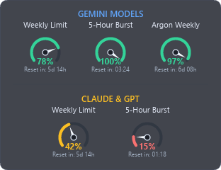

# Google AI Usage Monitor

A tiny native Windows HUD that shows your **Google Antigravity** AI quota (Gemini / Claude & GPT — Weekly and 5-Hour limits) right on top of the Antigravity window.

<p align="center">
  
</p>

> [!NOTE]
> This is an unofficial, community-made tool. It is not affiliated with or endorsed by Google.

## Features

- **Quota gauges at a glance** — Weekly Limit and 5-Hour Burst for both *Gemini Models* and *Claude & GPT*, color-coded by remaining quota.
- **Relative reset times** — e.g. `Reset in: 03:24` or `Reset in: 5d 14h`.
- **Sticks to Antigravity** — follows the bottom-right corner of the Antigravity window, hides while the window is moved/resized or minimized.
- **Never in your way** — fully click-through, and fades out automatically when the mouse cursor gets near it.
- **System tray icon** — shows the Gemini 5-Hour remaining % as a live ring icon. The tooltip shows all four values.
  - Left click: show / hide the HUD
  - Right click: menu (show/hide HUD, start with Windows, restart, exit)
- **Fresh data when you look** — quota refreshes every 5 minutes, and also immediately when you click the tray icon or when the HUD reappears.
- **Lightweight** — a single native Rust binary (Win32 + software vector rendering). No console window, no Electron, no WebView.

## Requirements

- Windows 10 / 11 (x64)
- [Google Antigravity](https://antigravity.google/) installed, running, and signed in

## Installation

Prebuilt binaries are not published yet. Build from source with Rust:

```powershell
cargo install --git https://github.com/ymtszw/google-ai-usage-monitor
```

Then run `google-ai-usage-monitor` (installed to `%USERPROFILE%\.cargo\bin`). It starts in the background; look for the ring icon in the system tray.

Alternatively, clone and build:

```powershell
git clone https://github.com/ymtszw/google-ai-usage-monitor
cd google-ai-usage-monitor
cargo build --release
.\target\release\google-ai-usage-monitor.exe
```

> [!TIP]
> Development and testing use the `stable-x86_64-pc-windows-gnu` toolchain. See [AGENTS.md](AGENTS.md) for the full setup.

## Start with Windows

Right-click the tray icon and check **Windows 起動時に自動起動** (start with Windows). Or from a terminal:

```powershell
google-ai-usage-monitor --register-startup    # enable
google-ai-usage-monitor --unregister-startup  # disable
google-ai-usage-monitor --status-startup      # show current status
```

This adds a per-user entry under `HKCU\Software\Microsoft\Windows\CurrentVersion\Run`. No administrator rights are needed.

## How it works

Antigravity runs a local language server (`language_server.exe`) that provides your quota summary to the editor. This tool:

1. Finds the language server process and reads its CSRF token from the process command line.
2. Finds the local port it listens on and calls its `RetrieveUserQuotaSummary` endpoint on `127.0.0.1`.
3. Draws the result as a layered, per-pixel-alpha overlay window aligned to the Antigravity window.

Everything stays on your machine. The tool sends no requests to the internet itself.

> [!WARNING]
> This relies on an undocumented internal API of Antigravity. An Antigravity update may break it at any time.

## Uninstall

1. Tray icon → **終了 (Exit)**
2. If you enabled auto-start: `google-ai-usage-monitor --unregister-startup`
3. `cargo uninstall google-ai-usage-monitor` (or delete the built executable)

## Contributing

Development setup, quality checks, architecture notes, and design guidelines are in [AGENTS.md](AGENTS.md).

## License

Licensed under the [MIT License](LICENSE).
