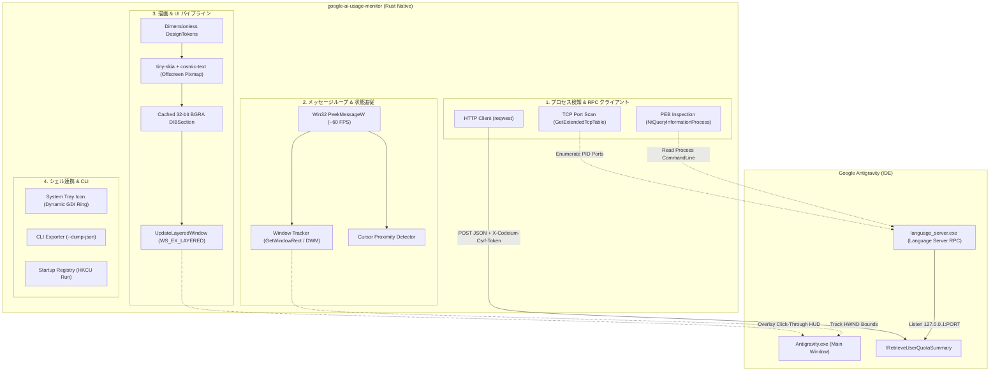
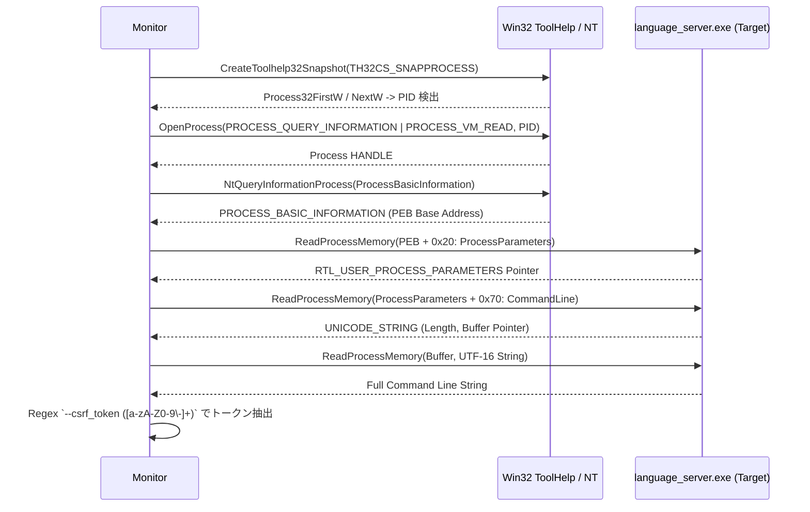
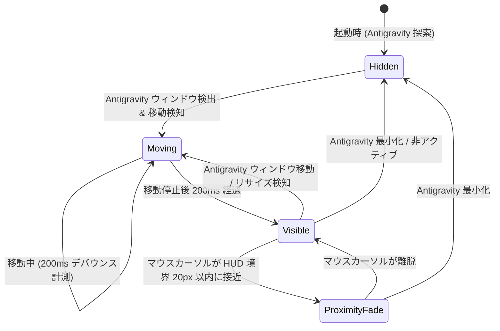

# Architecture Overview: Google AI Usage Monitor

本書では、**google-ai-usage-monitor** の内部アーキテクチャ、プロセス間通信、Win32 メッセージループ、Tiny-Skia 描画パイプライン、および PEB からのトークン抽出機構について包括的に解説します。

---

## 1. 全体トポロジー & システム構成

本ツールは、ローカルで稼働する **Google Antigravity** の内部プロセス (`language_server.exe`) を一切改変することなく、外部から安全にクォータ情報をポーリングし、Antigravity ウィンドウに吸着する透過 HUD オーバーレイおよびシステムトレイアイコンとして描画する Win32 ネイティブ常駐アプリケーションです。

---

## 2. プロセス解析 & PEB トークン抽出 (`src/quota.rs`)

Antigravity 内部の `language_server.exe` は、外部からの不正リクエストを遮断するために `--csrf_token <UUID>` を起動引数に指定して起動します。
本ツールは WMI などの重厚な WQL クエリに依存せず、Win32/NT ネイティブ API を直接利用してメモリ空間から超高速に CSRF トークンを抽出します。

### PEB 構造体の 64-bit オフセットレイアウト
Windows x64 において、プロセス環境ブロック (PEB) からコマンドライン文字列を取得する際のメモリレイアウトは以下の通りです:

1. `PEB + 0x20`: `ProcessParameters` (`*mut RTL_USER_PROCESS_PARAMETERS`)
2. `ProcessParameters + 0x70`: `CommandLine` (`UNICODE_STRING`)
   - `+0x00`: `Length` (u16)
   - `+0x02`: `MaximumLength` (u16)
   - `+0x08`: `Buffer` (`*mut u16` UTF-16 ポインタ)

---

## 3. ネットワーク探索 & クォータ RPC 通信 (`src/quota.rs`)

`language_server.exe` の PID を特定した後、プロセスが動的にバインドした待機ポート（IPv4）をスキャンして RPC リクエストを送信します。

1. **ポート探索 (`GetExtendedTcpTable`)**:
   - `AF_INET` および `TCP_TABLE_OWNER_PID_ALL` を指定して TCP 接続テーブルを取得。
   - `dwOwningPid == target_pid` かつ `dwState == 2` (`MIB_TCP_STATE_LISTEN`) のポートを列挙。
2. **RPC エンドポイント送信**:
   - URL: `http://127.0.0.1:{PORT}/exa.language_server_pb.LanguageServerService/RetrieveUserQuotaSummary`
   - Headers:
     - `Content-Type: application/json`
     - `X-Codeium-Csrf-Token: {CSRF_TOKEN}`
   - Body: `{}` (空 JSON)
3. **データ正規化**:
   - `QuotaResponseWrapper` -> `QuotaResponse` -> `GroupInfo` / `BucketInfo`。
   - Gemini (Weekly / 5h), Argon & Orchestrator (Weekly), Claude & GPT (Weekly / 5h) に分類・マッピング。

---

## 4. Win32 メッセージループ & 追従ステートマシン (`src/main.rs`, `src/tracker.rs`)

HUD は親ウィンドウを持たない独立したトップレベルウィンドウですが、ターゲットウィンドウに吸着して自然に連動します。

### ウィンドウの透過・非アクティブ特性
HUD はユーザーの作業を妨げないよう、拡張ウィンドウスタイルを組み合わせて完全な透過性を実現しています:
- `WS_EX_LAYERED`: アルファブレンド描画を有効化。
- `WS_EX_TRANSPARENT`: マウスクリックおよびヒットテストをすべて背後のウィンドウへ通過させる（クリック透過）。
- `WS_EX_TOOLWINDOW`: タスクバーや Alt+Tab 一覧から除外。
- `WS_EX_NOACTIVATE`: フォーカス奪取を禁止し、キーボード入力を妨げない。

### レンダリングとフェードアニメーションの分離
- **フル再描画**: クォータデータ更新時またはリサイズ時のみ `tiny-skia` によるピクセル描画を実行し、32-bit BGRA DIBSection にキャッシュ。
- **高速フェード**: 移動時やカーソル接近時のフェードイン・フェードアウトは、DIBSection を再描画せず、`UpdateLayeredWindow` の `BLENDFUNCTION.SourceConstantAlpha` のみを更新することで、CPU 負荷ゼロの滑らかなアニメーションを実現しています。

---

## 5. 無次元デザインシステム & Tiny-Skia 描画 (`src/overlay.rs`)

HUD の UI レイアウトは、絶対座標のハードコードを排した **無次元デザインシステム (`gui-dimensionless-design`)** に基づいて構築されています。

- **Base_Space** ($10.0\,\mathrm{px}$) および **Base_Text** ($10.5\,\mathrm{px}$) を基準単位として定義。
- ガウジの進行バー、インジケータードット、フォントサイズ、マージン・パディングの全比率を乗数スケーリングで算出。
- `cosmic-text` による高品質なフォントグリフのシェーピングと、`tiny-skia` によるサブピクセル精度のベクターラスタライズ。

---

## 6. CLI エクスポート & テストモック機構

### `--dump-json` (`src/cli_export.rs`)
ワンショット CLI フラグとして `--dump-json` を実装。
Windows サブシステム (`windows_subsystem = "windows"`) アプリケーションでありながら、`AttachConsole(ATTACH_PARENT_PROCESS)` を呼び出すことで、PowerShell や cmd から直接クォータの JSON 出力をパイプライン連携できます。

### TCP モックサーバー (`tests/mock_server.rs`)
テスト環境や CI 環境において、実機の `language_server.exe` が存在しない場合でも、`MockLanguageServer` を起動することで `RetrieveUserQuotaSummary` のエンドツーエンド通信、CSRF トークン検証、不正トークン拒絶（403）、および JSON パースを高速に決定論的テスト可能です。
